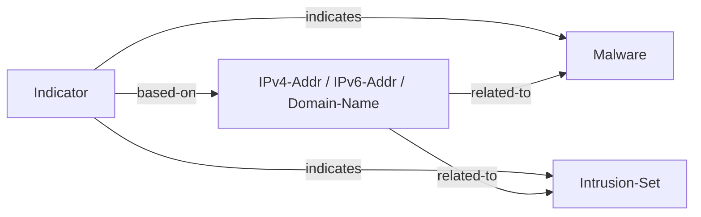

# OpenCTI CSIS Cyber Data Feed (CDF) Connector

| Status    | Date | Comment |
| --------- | ---- | ------- |
| Community | -    | -       |

Imports Indicators of Compromise (malicious domains and IP addresses) from the [CSIS Cyber Data Feed (CDF)](https://www.csis.com), linked to the associated malware families and, on the `advanced` feed, threat categories and threat actors.

## Table of Contents

- [Introduction](#introduction)
- [Installation](#installation)
- [Configuration](#configuration)
- [Deployment](#deployment)
- [Usage](#usage)
- [Behavior](#behavior)
- [Debugging](#debugging)
- [Additional information](#additional-information)

## Introduction

CSIS CDF provides two curated feeds of high-confidence malicious domains and IP addresses:

| Feed        | Rows (approx.) | Fields                                                              |
| ----------- | -------------- | ------------------------------------------------------------------- |
| `essential` | ~24,000        | `kind`, `value`, `first_seen`, `confidence_score`, `malware`        |
| `advanced`  | ~44,000        | All of the above, plus `category` and `threat_actors`               |

Each run downloads the full snapshot of every configured feed; no state is kept between runs.

## Installation

### Requirements

- OpenCTI Platform >= 7.261117.0
- A CSIS API account (OAuth2 client ID and secret) with the `https://api.csis.com/feed:read` scope

## Configuration

Configuration is read from environment variables (`docker-compose.yml`) or `config.yml` (manual deployment).

The full list of options, defaults and allowed values is in [`__metadata__/CONNECTOR_CONFIG_DOC.md`](__metadata__/CONNECTOR_CONFIG_DOC.md).

Connector-specific options:

| Parameter                 | config.yml                     | Environment variable           | Mandatory | Default    | Description                                                         |
| ------------------------- | ------------------------------ | ------------------------------ | --------- | ---------- | ------------------------------------------------------------------- |
| Client ID                 | `csis.client_id`               | `CSIS_CLIENT_ID`               | Yes       |            | CSIS OAuth2 client ID.                                              |
| Client secret             | `csis.client_secret`           | `CSIS_CLIENT_SECRET`           | Yes       |            | CSIS OAuth2 client secret.                                          |
| Feed types                | `csis.feed_types`              | `CSIS_FEED_TYPES`              | No        | `advanced` | `essential`, `advanced` or `essential,advanced`.                    |
| TLP level                 | `csis.tlp_level`               | `CSIS_TLP_LEVEL`               | No        | `amber`    | `clear`, `white`, `green`, `amber`, `amber+strict` or `red`.        |
| Minimum confidence score  | `csis.min_confidence_score`    | `CSIS_MIN_CONFIDENCE_SCORE`    | No        | `0`        | IOCs with a CSIS `confidence_score` (0-100) below this are skipped. |
| Request timeout (seconds) | `csis.request_timeout_seconds` | `CSIS_REQUEST_TIMEOUT_SECONDS` | No        | `60`       | Timeout for each request to the CSIS API.                           |

`CONNECTOR_DURATION_PERIOD` defaults to `PT6H`.

## Deployment

### Docker Deployment

Build the image:

```shell
docker build -t opencti/connector-csis:latest .
```

Set `OPENCTI_URL`, `OPENCTI_TOKEN`, `CONNECTOR_ID`, `CSIS_CLIENT_ID` and `CSIS_CLIENT_SECRET` in `docker-compose.yml`, then:

```shell
docker compose up -d
```

### Manual Deployment

Copy `config.yml.sample` to `config.yml` and fill in the values, then:

```shell
cd src
pip3 install -r requirements.txt
python3 main.py
```

## Usage

The connector runs every `CONNECTOR_DURATION_PERIOD`. To force an immediate run, go to **Data management → Ingestion → Connectors**, select the connector and click the refresh button.

## Behavior



For every IOC row:

| CSIS field         | OpenCTI                                                                                  |
| ------------------ | ---------------------------------------------------------------------------------------- |
| `kind`, `value`    | `IPv4-Addr`, `IPv6-Addr` or `Domain-Name` observable, plus a STIX `Indicator`            |
| `confidence_score` | `x_opencti_score` on the observable and indicator                                        |
| `first_seen`       | Indicator `valid_from`                                                                   |
| `malware`          | `Malware` (family), `indicates` from the indicator and `related-to` from the observable  |
| `threat_actors`    | `Intrusion-Set`, `indicates` from the indicator and `related-to` from the observable     |
| `category`         | Labels on the observable and indicator                                                   |

All objects are created by the `CSIS Cyber Data Feed (CDF)` organization and carry the configured TLP marking.

Objects are sent in bundles of about 5,000. Each bundle includes every Malware and Intrusion-Set it references, so bundles can be processed independently.

## Debugging

Set `CONNECTOR_LOG_LEVEL=debug` for verbose logs. Malformed feed rows are logged as warnings and skipped; a feed that fails to download is logged as an error and skipped without affecting the other configured feeds.

## Additional information

- OAuth2 access tokens expire after about 5 minutes; they are cached and refreshed automatically.
- The feed endpoint returns a `307` redirect to a signed Google Cloud Storage URL for a gzip-compressed NDJSON file. The redirect is followed without the CSIS `Authorization` header, which the signed URL rejects.
